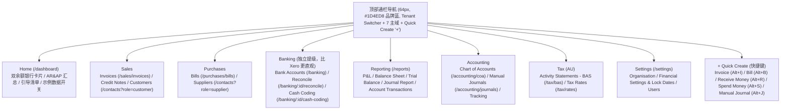

# 02_产品信息架构与页面设计（IA & Page Design）

> **设计依据（Traceability）：** 基于 `Xero-Research` [01_产品全景与交互设计.md](file:///d:/ai-work/au-faiw/xero%E8%B0%83%E7%A0%94/Xero-Research/01_%E4%BA%A7%E5%93%81%E5%85%A8%E6%99%AF%E4%B8%8E%E4%BA%A4%E4%BA%92%E8%AE%BE%E8%AE%A1.md) (`E01-NAV`, `E01-PAGE`–`E15-PAGE`) 提炼并精简重构。

---

## 1. 独立产品全局信息架构（Global IA）

继承 Xero **“商业视角优先 + 64px 顶部主导航无常驻左侧栏”** 的空间效率优势，同时彻底消除 Xero 历史 `.aspx` 与 `/app/` 割裂 URL，统一收敛为干净的 RESTful SPA 路由树（`/orgs/:orgId/...`）：

**相对 Xero 的主动优化点 (`Proposed`)：**
1. **将 `Banking` 提为一级菜单：** 在 Xero 中 `Bank accounts` 藏在 `Accounting` 下，但中小企业最高频动作是银行对账与收支编码，独立提级减少一次点击路径。
2. **所有 URL 均具备显式租户上下文 `/orgs/:orgShortCode/...`：** 支持多标签页同时打开不同客户账套而不串会话。

---

## 2. MVP 核心页面清单与功能定位

| 页面编号 | 路由 | 名称 | MVP 形态 | 核心交互职责 | 追溯证据 |
|---|---|---|---|---|---|
| **P-01** | `/dashboard` | 组织首页 | **完整核心** | 展示 Bank（Statement vs Book 双余额）、AR 待收/逾期、AP 待付、快速进入 Reconcile；空账套可切换“示例预览模式” | `E01`, `E11` |
| **P-02** | `/settings/financial` | 财务与锁账设置 | **完整核心** | 财年末 (`30 June`)、GST Accounting Basis (`Accrual`/`Cash`)、BAS `G1` 口径（Inclusive/Exclusive）、Tax Defaults、**两层 Lock Dates**、配置变更日志 | `E03`, `E19` |
| **P-03** | `/accounting/coa` | 会计科目表 | **完整核心** | 分类 Tab、搜索、启用/归档（有余额/系统锁保护）、默认税码分配、展示 `820 GST` 与系统锁徽标 | `E04-PAGE`, `E04-COA` |
| **P-04** | `/tax/rates` | 税率管理 | **完整核心** | 展示 AU 标准税率、`canApplyTo*` 适用规则与复合税成分；内置系统税率禁止删除 | `E05`, `E06-NET` |
| **P-05** | `/accounting/journals` | 手工日记账列表与编辑器 | **完整核心** | `Draft/Posted/Voided` 过滤、**47 非系统科目下拉隔离**、Auto-reversing、Cash basis 标记、含/不含税切换、剪贴板批量粘贴行、Bottom Sticky Actions (`Save Draft`/`Post`) | `E06`, `E07` |
| **P-06** | `/sales/invoices` | 销售发票列表与编辑 | **轻量化真内核** | `Draft -> Authorised -> Paid/Voided` 切页、行内联系人选择、Tax Incl/Excl 实时行重算、Approve 即过账 GL | `E14`, `E15`, `E21` |
| **P-07** | `/purchases/bills` | 采购账单列表与编辑 | **轻量化真内核** | 同对称 UI 组件复用于供应商账单（默认 Tax Inclusive），支持 Approve 记入 `800 AP` + 进项 `820 GST` | Demo Bills |
| **P-08** | `/banking/:id/reconcile` | 双栏银行对账页 | **完整核心** | 顶部 Twin Balance 条；左栏未对账银行流水、右栏 `Match`（匹配未付单据一键 **OK**）/ `Create`（直接编码 `Receive/Spend Money`）/ `Transfer`；CSV 一键导入向导 | `E12`, `E22`, `E23` |
| **P-09** | `/banking/:id/cash-coding` | Cash Coding 批量网格 | **精简版完整核心** | 类电子表格高频网格，支持全选批量填入 Contact / Account / Tax Rate 并一键 `Save & Reconcile` 生成 `BankTransaction` | `E13` |
| **P-10** | `/reports/:type` | 报表引擎统一壳 | **完整核心** | 顶部 `Date / Compare / Accounting Basis (Accrual|Cash) / Update` 参数条；支持 **Journal Report**、**Trial Balance**、**P&L**、**Balance Sheet**、点击数字穿透至 **Account Transactions** | `E08`, `E09`, `E16–E18`, `E24–E27` |
| **P-11** | `/tax/bas` | AU Simpler BAS 申报工作台 | **完整核心** | 汇总视图（`G1`, `1A`, `1B`, `8A/8B`, `Payment 9`）、`Transactions` 明细穿透按 TaxRate 分组、`Unfiled amounts` 水位线提示、Manual Adjustment、`Save Draft / Finalise` | `E20`, `E28`, `E28b` |
| **P-12** | `/contacts` & `/accounting/tracking` | 联系人与追踪维度 | **轻量化真内核** | 联系人 CRUD（Customers/Suppliers 自动视图）；Tracking 最多 2 个激活维度设置 | Demo Contacts/Tracking |
| **P-99** | `/payroll`, `/assets`, `/inventory` | P2 占位模块 | **占位声明页** | 清晰告知当前处于 Phase 2 规划，并提供快速跳转到 Manual Journals 做薪资/折旧入账引导 | `调研需求` 第10章 |

---

## 3. 通用表单与交互规范（供 AI 前端实现对齐）

1. **财务表格等宽对齐：** 所有货币金额列强制使用 `font-variant-numeric: tabular-nums; text-align: right;`，正负金额清晰（资产负债表负值使用会计括号 `(7,912.00)` 或负号可配置）。
2. **底部粘性操作栏（Sticky Action Bar）：** Invoice、Bill、Manual Journal 编辑页底部固定显示 `Cancel`、`Save as Draft`（次要按钮）、`Approve / Post`（主蓝色按钮），减少长单据滚动寻找按钮成本 (`E07`, `E21`)。
3. **行级单价与税额即时预览：** 用户输入 Qty / Unit Price / Discount / Tax Mode 时前端实时预演每行 Net / Tax / Total 供核对，**但最终过账写入总账与单据总额必须由后端定点数引擎重新权威计算并落库**，防止前端被篡改。
4. **不可逆动作二次确认 + 因果说明：** 执行 `Void Invoice`、`Finalise BAS`、`Set Hard Lock Date` 时弹窗明确列出总账/税务后果。
