# 04_数据模型与API设计（SQLite + Flask 全量契约）

> **数据库文件：** [accounting_core_sqlite.sql](./schemas/accounting_core_sqlite.sql)（33 张表 + 6 个不可变触发器）  
> **API 契约文件：** [openapi-mvp.yaml](./schemas/openapi-mvp.yaml)  
> **种子基准：** [au-seed-data.json](./schemas/au-seed-data.json)（54 COA + 11 AU TaxRates）

---

## 1. 核心数据模型关系总览（ER 脉络）

```mermaid
erDiagram
    organisations ||--|| org_settings : has
    organisations ||--|| org_counters : sequences
    organisations ||--o{ org_memberships : grants
    organisations ||--o{ accounts : owns
    organisations ||--o{ tax_rates : configures
    organisations ||--o{ contacts : manages
    organisations ||--o{ products : catalogs
    organisations ||--o{ tracking_categories : defines
    tracking_categories ||--o{ tracking_options : contains

    organisations ||--o{ quotes : issues
    quotes ||--o{ quote_lines : items
    organisations ||--o{ purchase_orders : orders
    purchase_orders ||--o{ purchase_order_lines : items

    organisations ||--o{ invoices : records
    invoices ||--o{ invoice_lines : lines
    invoices ||--o{ credit_note_allocations : offsets
    invoices ||--o{ payments : settles

    organisations ||--o{ bank_statement_lines : imports
    organisations ||--o{ bank_transactions : posts
    organisations ||--o{ bank_rules : automates

    organisations ||--o{ journals : appends
    journals ||--o{ journal_lines : balances
    organisations ||--o{ manual_journals : wraps
    organisations ||--o{ bas_statements : snapshots
```

### 1.1 针对 Phase 1 审查的关键表修正说明
1. **`accounts` 表：** 同时保留 `is_system_locked`（禁止删除/归档与修改核心类型）与 **`manual_journal_excluded`**（精准控制 `497, 498, 610, 630, 800, 801, 877` + 所有 `BANK` 账户无法在手工日记账选中，严格保持 47/54 可选比例），以及 `enable_payments_to_account` 与 `show_on_watchlist`。
2. **新增 `credit_note_allocations` 表：** 将销售/采购 Credit Note 与原发票/账单的核销关系、核销日期（`allocation_date`）与金额持久化；驱动未结余额计算、防止超额核销，并精准支撑 Cash Basis 下“核销日才计入 Cash P&L 与 BAS”的实测规则（`E35/E36`）。
3. **新增 `quotes` / `purchase_orders` / `products` / `bank_rules` / `conversion_balance_entries` / `find_recode_batches` / `connected_apps` 表：** 全链路打通“报价->开票->退货核销”与“申购->账单->银行规则对账/Cash Coding->期末调账/重分类->报表与 BAS 定稿”全闭环。

---

## 2. RESTful API 完整分组契约（Flask `/api/v1`）

| 业务域 | 核心接口端点 | 说明与核心规则 |
|---|---|---|
| **Auth & Org** | `GET /auth/me`, `POST /auth/switch-role`, `GET/POST /orgs`, `GET /orgs/{orgId}/dashboard` | 登录会话与快速演示切换（Adviser/Standard/ReadOnly）、Homepage 双余额与图表聚合 |
| **Settings** | `GET/PATCH /orgs/{orgId}/settings/financial`, `GET/PATCH /orgs/{orgId}/settings/organisation`, `GET/PUT /orgs/{orgId}/conversion-balances`, `POST /orgs/{orgId}/conversion-balances/post` | Soft/Hard Lock Date 校验（`hard <= soft`、Adviser 权限）、ABN/前缀、Conversion 轧差 `840` 并过账 |
| **COA & Tax & Tracking & Products** | `GET/POST/PATCH/DELETE /orgs/{orgId}/accounts`, `GET /orgs/{orgId}/tax-rates`, `GET/POST/PATCH /orgs/{orgId}/tracking-categories`, `GET/POST/PATCH /orgs/{orgId}/products` | 支持 `?excludeManualExcluded=true` 返回 47 个可用科目；Archived/HasTx 保护；Tracking 上限 2 组 |
| **Contacts** | `GET/POST/PATCH/POST merge /orgs/{orgId}/contacts` | 聚合实时 `youOwe` 与 `theyOwe`，带默认销售/采购科目税码及 ABN |
| **Quotes & POs** | `GET/POST/PATCH /quotes`, `POST /quotes/{id}/convert`, `GET/POST/PATCH /purchase-orders`, `POST /purchase-orders/{id}/convert` | 不写总账；一键无损转 Invoice / Bill 并流转状态 |
| **Invoices, Bills & Credit Notes** | `GET/POST/PATCH /invoices`, `POST /invoices/{id}/approve`, `POST /invoices/{id}/void`, `POST /invoices/{id}/allocate`, `GET/POST/DELETE /payments` | `invoiceType` 涵盖 4 类单据；服务端逐行权威计算 GST；批准生成不可变分录；Void 生成冲销分录 |
| **Banking, Rules & Cash Coding** | `GET /bank-accounts`, `POST /bank-accounts/{id}/statement-lines/import`, `GET /bank-accounts/{id}/suggestions`, `POST /bank-accounts/{id}/reconcile`, `POST /bank-accounts/{id}/cash-coding/apply`, `POST /bank-accounts/{id}/unreconcile`, `POST /bank-accounts/{id}/remove-redo`, `GET/POST/PUT/DELETE /bank-rules` | 带 `occurrence_idx` CSV 导入；Match/Find&Match/Adjustment/Create/Transfer；Rule 按顺位 Any/All+Fixed/Percent 自动生成建议；Cash Coding 批过账；`version` 409 防并发 |
| **Manual Journals & Find/Recode** | `GET/POST/PATCH /manual-journals`, `POST /manual-journals/{id}/post`, `POST /manual-journals/{id}/void`, `POST /find-and-recode` | Draft/Posted/Voided/Edit（底层 Append Reversal + New）；Auto-Reversing 同步写双分录；支持 Tax Exclusive/Inclusive；Adviser 批量重分类入审计台 |
| **Reports & Cashflow & Audit** | `GET /reports/trial-balance`, `GET /reports/profit-and-loss`, `GET /reports/balance-sheet`, `GET /reports/journals`, `GET /reports/account-transactions`, `GET /reports/general-ledger`, `GET /reports/aged-receivables`, `GET /reports/aged-payables`, `GET /analytics/cash-flow`, `GET /audit-logs`, `GET /assurance` | 严格只读汇总 `journals` + `payments` + `allocations`；BS 动态计算 CYE/RE 与透支银行重分类；支持 `?basis=ACCRUAL|CASH` |
| **AU Simpler BAS & Apps** | `GET /bas/statement`, `GET /bas/history`, `POST /bas/statement/finalise`, `GET/POST /connected-apps` | Whole dollars 输出、Cash/Accrual、G1 含/不含税切换、Finalise 水位线冻结与 Unfiled amounts 计算 |
