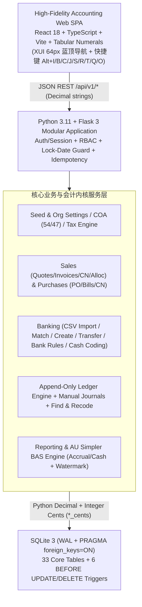

# 05_系统技术架构（Python + Flask + SQLite + High-Fidelity SPA）

> **修订说明：** 经 Phase 1 审查确认，本独立会计 SaaS 正式确定技术栈为 **Python 3.11 + Flask REST API + SQLite 3（WAL + 整型分 + Append-Only Triggers）+ React 18 / TypeScript / Vite 高保真 Xero 复刻前端**，彻底淘汰遗留 `.aspx` 混合模式并统一前后契约。

---

## 1. 整体技术架构图



---

## 2. 关键工程技术决策

### 2.1 SQLite 金融精度与不可变总账策略
1. **货币精度防漂移：**
   - **数据库层：** 所有汇总金额、发票余额、分录借贷额、银行对账单额全部采用 `INTEGER` 存储最小单位分（`AUD * 100`，例如 `$110.00 -> 11000`）；税率 `0.1000` 及单价数量小数（支持 4 位小数）使用规范化字符串 `TEXT`，进入计算前全部转为 Python 标准库 **`decimal.Decimal`** 并设定 **`ROUND_HALF_UP`**（商业行级至分）完成精确四舍五入。
   - **API 契约层：** 所有 JSON 货币字段以十进制两位小数字符串传输（如 `"110.00"`），彻底隔离 IEEE-754 浮点数。
2. **数据库引擎强制只增不改（Append-Only）：**
   - 在 SQLite `journals`、`journal_lines` 与 `audit_logs` 表上均创建 `BEFORE UPDATE` 与 `BEFORE DELETE` 触发器（`SELECT RAISE(ABORT, 'LEDGER_IMMUTABLE...')`），从存储底座彻底杜绝覆写历史分录。
3. **写并发与事务一致性：**
   - 启用 SQLite **`PRAGMA journal_mode = WAL`** 与 `busy_timeout = 5000`，确保单写多读高吞吐；所有批准发票、核销、银行对账、手工分录过账与 BAS 定稿均在单个 `BEGIN IMMEDIATE` 原子事务中完成，并在关键并发接口支持 `version` 乐观锁（返回 `409 Conflict`）与 `Idempotency-Key` 幂等重放。

### 2.2 租户边界、权限与安全防护
- **严格多租户隔离：** 每次请求均需经由组织上下文中间件验证当前用户成员身份（`org_memberships`）及目标路由 `/orgs/<orgId>/*`，所有 SQL 查询均强制带上 `WHERE org_id = ?`。
- **RBAC 与双锁联动：** 支持切换或登录 **`ADVISER`**、**`STANDARD`**、**`READONLY`** 三类核心角色，精确对应 Financial Settings 锁账保存、`Find & Recode` 权限、以及 `Soft Lock Date`（Adviser 豁免 vs Standard 拦截）与 `Hard Lock Date`（全角色硬拦并返回 `422 PERIOD_HARD_LOCKED`）。
- **无 Xero 商标/专有资源复制：** 所有前端图标、组件、配色 Token 均由自研代码与标准矢量实现，独立打包于 Vite 生产产物并可由 Flask 统一托管或前后端联调运行。

---

## 3. 目录与运行部署架构

```text
app/
├── backend/
│   ├── app.py                   # Flask 工厂 + 蓝图注册 + 静态托管
│   ├── db.py                    # SQLite WAL 连接、Decimal/Cents 工具、Trigger 初始化
│   ├── seed_au.py               # AU 54 COA + 11 TaxRates + Demo/Sample 播种器
│   ├── services/
│   │   ├── ledger.py            # 不可变分录流 + Auto-Reverse + Lock Guard + 47 科目过滤
│   │   ├── documents.py         # Quotes / POs / Invoices / Bills / Credit Notes / Allocations
│   │   ├── banking.py           # CSV Import (occurrence_idx) / Match / Create / Transfer / Rules / Cash Coding
│   │   ├── reports.py           # P&L (Accrual/Cash) / BS (Virtual Close & Overdraft) / TB / GL / Aged AR&AP / CashFlow
│   │   └── bas.py               # Simpler BAS (G1/1A/1B/9) + Finalise Watermark + Unfiled Amounts
│   ├── routes/                  # /api/v1/* Flask Blueprints
│   └── tests/                   # pytest 单元测试 / Trigger 不可变 / 夹具回归 / 并发测试
└── frontend/
    ├── src/                     # React + TypeScript + Vite 高保真 SPA
    └── e2e/                     # Playwright 真实浏览器端到端验收测试
```
