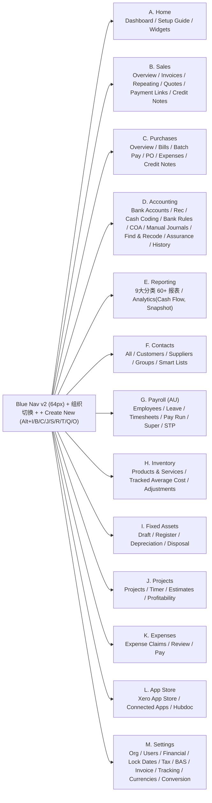
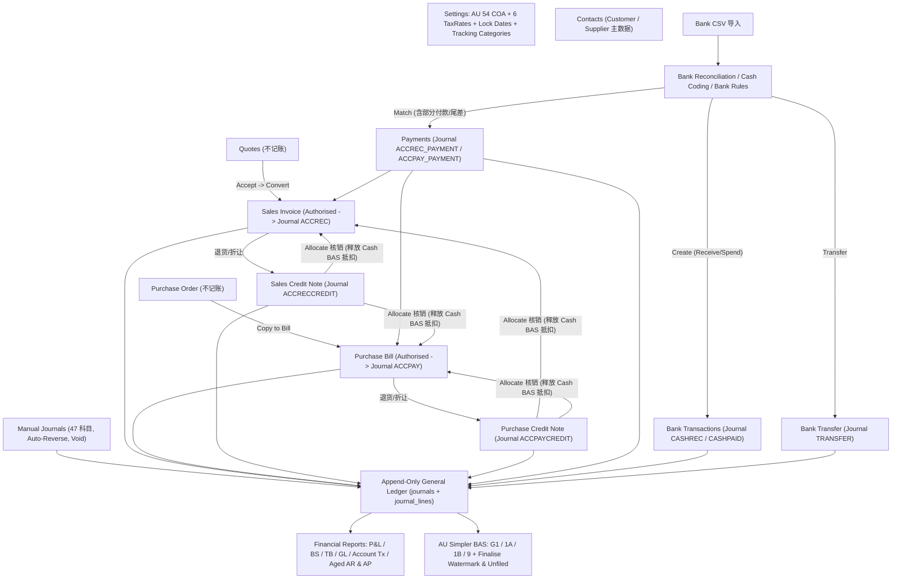

# 01_Xero全站产品功能地图（AU 版）

> **研究范围：** Xero Web 澳大利亚区（AU）全站 13 大功能域（`A. Home` 至 `M. Settings` + 全局快捷键与工具栏）。  
> **对照组织：** 空账套测试组织（`!W5gW!`，AU Starter/Trial）与 Xero 官方 AU 示例公司（`!VD61z`，Demo Company AU）。  
> **研究状态图例：** `已探索`（已实操验证页面与主要流转）/ `部分探索`（已进入主列表或详情页，子弹窗或边界动作待全量实测）/ `未探索` / `权限或套餐受限`（须指定角色/付费功能开关才可见）/ `已记录边界`。  
> **独立复刻开发分级：** `完整实现` / `简化实现` / `页面占位` / `接口预留` / `暂不实现`。

---

## 一、全站模块树与导航关系图

---

## 二、权限、套餐与前置条件门控清单（区分“不存在” vs “当前不可访问”）

| 功能 / 页面 | `!W5gW!`（Trial/Standard）初始表现 | `!W5gW!` 提权为 Administrator 或切换 Demo `!VD61z` 实测表现 | 门控根因分类 |
|---|---|---|---|
| **Financial Settings — Lock Dates 保存** | 按钮灰色禁用 (`E03`) | 升级 `Administrator + Adviser` 后立即解锁可设软硬锁 (`E37`) | **角色权限**（须 Adviser/Admin） |
| **Cash Coding (`FastCoding.aspx`)** | `!W5gW!` 下直访返回 404 (`E23`) | `!VD61z` 导航与 Bank Account Tab 完整可用 (`E44`) | **订阅套餐 / Feature Flag**（Cash Coding 需 Business 版本） |
| **Find and recode** | `!W5gW!` 初始未显现 | `!VD61z`（Adviser 视图）完整展示列表与 Recode Audit History | **角色权限**（仅 Adviser 可见） |
| **Tracked Inventory (`630 Inventory`)** | `<4,000` SKU 限额提示，无初始货物 (`E38`) | `!VD61z` 完整展示移动加权平均成本、库存数量、在途订单、Inventory Adjustment (`E41`) | **数据前置条件 + 订阅** |
| **AU Payroll (`Pay employees`)** | 首次进入跳 `/payroll/onboarding` 初始化向导 (`E38`) | `!VD61z` 导航展开全部 Payroll 子模块（STP/Super/Leave） | **组织配置初始化前置** |
| **Fixed Assets** | 未设置 Start Date 时不可折旧 (`E38`) | `!VD61z` 完整展示 `Draft / Registered / Sold/disposed` 资产登记簿 | **Start Date 前置配置** |
| **ATO SBR / PLS 直连申报** | BAS 页面顶部显示 `Not connected to ATO` | 属澳大利亚税务局（ATO）官方机器凭证网关 | **外部监管第三方认证依赖** |
| **Bank Feeds（直连银行流）** | Trial 可用手工 CSV 导入 (`E11`) | 真实银行（CBA/ANZ/NAB/Westpac）须企业银行授权协议 | **第三方银行牌照与商业协议** |

---

## 三、全站 13 大功能域完整功能地图（Pages, Roles, Dependencies, Status & Replication Scope）

| 域 | 子功能模块 | 核心页面路由（实测） | 解决的业务问题 | 依赖模块 | 主要角色 | 重要度 | 研究状态 | 本产品复刻范围 |
|---|---|---|---|---|---|---|---|---|
| **A. Home** | Dashboard 概览与双余额卡 | `/app/*/homepage` | 一屏掌握银行真实差额、AR/AP 欠款、现金流柱图、待办 | Bank, Invoices, Bills, Reporting | All | P0 核心 | **已探索** (`E01,E39`) | **完整实现** |
| **A. Home** | Setup Guide & Demo 预览开关 | `/app/*/homepage` | 新手 9 步冷启动引导 + 空账套预览真实图表 | Settings | Subscriber, Admin | P1 | **已探索** (`E01`) | **完整实现** |
| **A. Home** | 全局 `+ Create new` 快捷菜单 | 全局 Shell 顶部 | 不跳转列表页、`Alt+I/B/C/J/S/R/T/Q/O` 秒级新建单据 | Invoices, Bills, MJ, Bank, Contacts | Standard, Adviser | P0 核心 | **已探索** (`E01`) | **完整实现** |
| **B. Sales** | Sales overview 销售驾驶舱 | `/app/*/sales/overview` | 按状态计数 Draft/Awaiting/Overdue、大客户欠款排行、Stripe 在线收款摘要 | Invoices, Quotes, Contacts | Owner, Sales | P1 | **已探索** (`E40`) | **完整实现** |
| **B. Sales** | Sales Invoices（销售发票 + Credit Note + 核销） | `/AccountsReceivable/Search.aspx` `/AccountsReceivable/Edit.aspx` | 正式销售开票、权责确认收入 (`200`)、应收 (`610`) 与销项税 (`820`)、退货冲减与 Allocate | Contacts, COA, Tax, Inventory | Standard, InvoiceOnly, Adviser | P0 核心 | **已探索** (`E21,E33,E35`) | **完整实现** |
| **B. Sales** | Quotes（报价单转发票） | `/app/*/quotes-list` | 给客户出估算报价（Draft/Sent/Declined/Accepted/Invoiced/Expired），不记账，成交一键转 Invoice | Contacts, Products | Standard, Sales | P1 | **已探索** | **完整实现** |
| **B. Sales** | Repeating Invoices（周期性订阅发票） | `/AccountsReceivable/SearchRepeating.aspx` | 每月自动按模板生成月费账单 | Contacts, COA, Tax | Standard, Adviser | P1 | **部分探索** (`E40` 入口) | **简化实现** |
| **B. Sales** | Online Invoice & Payment Links | `/app/*/payment-links` | 给客户发带 Pay Now 的独立链接收款 | Stripe/PayPal (第三方) | Standard | P2 外围 | **部分探索** (`E40`) | **页面占位+接口预留** |
| **C. Purchases** | Purchases overview & Bills（采购账单 + Credit Note） | `/Accounts/Payable/Dashboard/` `/app/*/bills` | 录入供应商发票、确认费用/资产与进项 GST (`1B`)、应付账款 (`800`)、批复付款 | Contacts, COA, Tax | Standard, Adviser | P0 核心 | **已探索** (`E30,E36`) | **完整实现** |
| **C. Purchases** | Purchase Orders（采购订单） | `/app/*/purchase-orders/list/` | 采购前审批下单（Draft/Awaiting approval/Approved/Billed），不直接入总账，收货后转 Bill | Contacts, Inventory | Standard | P1 | **已探索** | **完整实现** |
| **C. Purchases** | Online Bill Payments / Batch Payments | `/app/*/payments` | ABA 银行批量付款文件导出或直付供应商 | Bank, Bills | Standard, Adviser | P2 | **部分探索** | **简化实现**（单据直接录 Batch/Pay） |
| **D. Accounting** | Bank Accounts & Twin Balances | `/app/*/manage-bank-accounts` | 管理所有银行/信用卡/PayPal 账户，对比银行真实余额与账面余额 | Banking, Journals | Adviser, Standard | P0 核心 | **已探索** (`E11,E43`) | **完整实现** |
| **D. Accounting** | Bank Reconciliation（Match / Create / Transfer / Discuss） | `/BankRec/BankRec.aspx` | 导入银行 CSV 流水，逐条智能匹配未结发票账单（Split/Adjust）或新建收付款、内部转账 | Invoices, Bills, Payments, Journals | Adviser, Standard | P0 核心 | **已探索** (`E22,E23,E26,E43`) | **完整实现** |
| **D. Accounting** | Cash Coding（类 Excel 批量对账） | `/Bank/FastCoding.aspx` | 表格批选批量指定科目/税率/追踪分类，配合 Rule 秒级 Save & Reconcile All | Bank Rules, COA, Tax | Adviser, Standard | P1 | **已探索** (`E44`) | **完整实现** |
| **D. Accounting** | Bank Rules（3 类自动记账规则） | `/app/*/bank-rules/*` | Spend / Receive / Transfer 规则引擎（Any/All 条件 + 固定值 + 百分比拆分），自动预填对账建议 | Bank Rec, Cash Coding, Contacts | Adviser, Standard | P1 | **已探索** (`E42`) | **完整实现** |
| **D. Accounting** | Spend / Receive / Transfer Money & Review Reconciled / Unreconcile | `/Bank/BankTransactions.aspx` `/app/*/bank-rec/reconciled-transactions` | 手工直接记录资金流或对已对账交易执行解绑（Unreconcile）/ 作废重做（Remove & Redo） | Bank Accounts, Journals | Adviser, Standard | P0 核心 | **已探索** (`E26,E34`) | **完整实现** |
| **D. Accounting** | Chart of Accounts（科目表与系统控制锁） | `/GeneralLedger/ChartOfAccounts.aspx` | 维护 AU 54 标准科目、新增银行/普通科目、批量归档与默认税率设置 | Tax Rates, Journals | Adviser, Standard | P0 核心 | **已探索** (`E04`) | **完整实现** |
| **D. Accounting** | Manual Journals（手工会计凭证 + 自动冲销 + 含税模式） | `/app/*/journals` | 月末预提/摊销/折旧/更正分录，支持 Draft/Posted/Voided/Edit、Auto-Reverse 与 Tax Exclusive/Inclusive | COA(47), Tax, Lock Dates | Adviser | P0 核心 | **已探索** (`E06,E29,E37`) | **完整实现** |
| **D. Accounting** | Find and Recode（批量重分类） | `/Accounts/Recoding` | 会计师批量检索错账交易并统一改科目/税码/Tracking 并生成 Audit Report | GL, COA, Tax, Tracking | Adviser | P1 | **已探索** | **完整实现** |
| **D. Accounting** | Assurance Dashboard & History and Notes | `/app/*/assurance-dashboard` `/app/*/activity-summary` | 防舞弊异常监测（用户活跃热力图、人工改流水、共享收款账户、删改单据）+ 全量操作审计日志 | All Modules | Adviser | P1 | **已探索** | **完整实现** |
| **D. Accounting** | Conversion Balances（期初开账平衡） | `/Setup/Welcome/EditConversionBalances.aspx` | 从旧软件迁移切换时录入各科目期初余额，用 `840 Historical Adjustment` 轧差，并核对历史 AR/AP | COA, Invoices, Bills | Adviser | P0 核心 | **已探索** | **完整实现** |
| **E. Reporting** | 核心财务三表 + 总账与试算 | `reporting.xero.com` | **P&L (Accrual/Cash)**、**Balance Sheet (动态结转与负银行重分类)**、**Trial Balance**、**Journal Report**、**GL Detail**、**Account Transactions** | Journals (Append-Only) | ReadOnly+ | P0 核心 | **已探索** (`E16-E19,E25`) | **完整实现** |
| **E. Reporting** | 往来账龄与税表 | `reporting.xero.com` | **Aged Receivables Summary/Detail**、**Aged Payables Summary/Detail**、**GST Reconciliation**、**Reconciliation Report** | Invoices, Bills, Payments, Tax | ReadOnly+ | P0 核心 | **已探索** | **完整实现** |
| **E. Reporting** | Analytics 现金流预测与商业快照 | `/app/*/cashflow` `/app/*/business-snapshot/` | 未来 7/30/90 天资金净流预测 + 毛利率/周转率经营指标 | Bank, Invoices, Bills | Standard+ | P1 | **已探索** | **完整实现** |
| **E. Reporting** | Custom Layouts & Management Pack (Draft/Published/Archived) | `reporting.xero.com/home` | 报表科目拖拽分组、管理层正式发布报告包归档 | Reporting | Adviser | P2 | **部分探索** (`E08`) | **简化实现** |
| **E. Reporting** | **Tax (AU): Simpler BAS Activity Statements** | `/app/*/bas` | 计算 `G1`、`1A`、`1B`、`8A`、`8B`、`Payment 9`（Accrual/Cash），支持 `Finalise` 冻结水位线与延迟分录 `Unfiled amounts` 补算 | Journals, Payments, Allocations | Adviser, Standard | P0 核心 | **已探索** (`E20,E28,E32,E35,E36`) | **完整实现** |
| **E. Reporting** | TPAR（建筑/IT/清洁外包商年报） | `/app/*/tpar` | 汇总结算全年支付给分包商（Contractor Group）的总额向 ATO 申报 | Contacts, Bills | Adviser | P2 地区专项 | **已探索** | **页面占位+数据扩展** |
| **F. Contacts** | 客户/供应商统一主数据、分组与合并 | `/app/*/contacts/*` | 同一联系人兼任 Customer/Supplier、显示 `You owe / They owe`、Contact Groups、合并重复与默认税率科目 | Sales, Purchases, Banking | Standard+ | P0 核心 | **已探索** | **完整实现** |
| **G. Payroll (AU)** | 员工、排班、请假、Pay Run、Super 与 STP | `payroll.xero.com` `/app/*/payroll/*` | 澳洲工资核算、PAYG 代扣税、SuperStream 养老金与 ATO Single Touch Payroll 实时报税 | Bank, 804/825/826 科目, ATO STP | Payroll Admin | P2 重资产域 | **已探索边界** (`E38`) | **页面占位+接口预留** |
| **H. Inventory** | Products & Services（无追踪目录 vs 追踪库存） | `/app/*/products-and-services` | SKU 单价预设；Tracked SKU（`630 Inventory`）自动按移动加权平均计算 COGS (`310`) 并支持盘点调账 (`New adjustment`) | Invoices, Bills, 630/310 | Standard+ | P1(目录)/P2(追踪) | **已探索** (`E38,E41`) | **目录完整实现；追踪库存扩展占位** |
| **I. Fixed Assets** | 固定资产卡片、批注折旧与处置 | `/app/*/fixed-assets/*` | 将资本性采购自动转 Draft 资产，按直线法/余额递减法 Run depreciation 并生成月度折旧分录 | COA (710-721), Manual/System Journals | Adviser | P2 重资产域 | **已探索** (`E38`) | **页面占位+折旧扩展预留** |
| **J. Projects** | 项目立项、工时计费、预算与盈利分析 | `/app/*/projects` | 跟踪咨询/工程项目耗时与直接成本对比 Estimate 与开票进度 | Invoices, Expenses, Contacts | Standard | P2 外围域 | **已探索** (`E38`) | **页面占位+接口预留** |
| **K. Expenses** | 员工垫付费用报销与审批付款 | `/app/*/expenses/` | 员工拍小票报销（Submitted -> Approved -> Paid），过账到 `801 Unpaid Expense Claims` | Bills/Bank, 801 | Employee, Standard | P2 外围域 | **已探索** | **页面占位+接口预留** |
| **L. App Store** | 第三方应用市场与 OAuth 授权管理 | `apps.xero.com` | 发现电商/POS/CRM/报销集成应用，授权 OAuth Scopes 与断开连接 | Auth, API Webhooks | Admin | P2 生态 | **已探索** | **页面占位+集成中心** |
| **M. Settings** | 组织信息、用户角色权限、财务设置与双层锁账、税率、Tracking Categories、Invoice 设置、审计历史 | `/app/*/settings` `/Setup/*` | 组织 ABN/FY End、3+ 角色权限、Soft/Hard Lock Dates、6 Active TaxRates、2 组 Tracking Categories（如 Region）、编号与提醒 | 全站基础设施 | Subscriber, Adviser | P0 核心 | **已探索** (`E02,E03,E05,E37`) | **完整实现**（多币种 Fx Rates 保留扩展） |

---

## 四、核心模块跨模块业务协同链路图

