# 01_产品全景与交互设计

> **范围：** Xero Web 澳大利亚区（AU）产品壳、全局信息架构、核心页面布局、前端工程模式与可复用交互设计。  
> **证据基准：** `E01-PAGE`、`E01-NAV`、`E02-PAGE`、`E03-PAGE`、`E04-PAGE`、`E04-COA`、`E05-PAGE`、`E06-PAGE`、`E06-NET`、`E07-PAGE`、`E08-PAGE`、`E09-PAGE`、`E10-SNAP`（采集于 2026-11-14）。

---

## 1. 产品整体信息架构（Information Architecture）

### 1.1 顶层结构与多域路由特征

**Observed (`E01-NAV`, `E01-PAGE`)：** Xero Web 并非单一的 SPA，而是由统一蓝色顶部导航栏（`Top navigation bar`）串联的多应用、多子域集群，URL 路径同时反映出其从经典 ASP.NET WebForms/MVC 向现代 React MFE 渐进迁移的演进痕迹：

| 子域 / 路径模式 | 承载模块 | 代表路由（Observed） | 架构世代特征 |
|---|---|---|---|
| `go.xero.com/app/<SHORTCODE>/*` | Homepage、Settings、Bills、Expenses、Contacts、Projects、Manual Journals、BAS Settings | `/app/!W5gW!/homepage` `/app/!W5gW!/settings` `/app/!W5gW!/journals` | 现代微前端 Shell + SPA/MFE |
| `go.xero.com/*.aspx` | Sales Invoices、Chart of Accounts、Bank Accounts、Financial Settings、Tax Rates、Transfer Money | `/AccountsReceivable/Search.aspx` `/GeneralLedger/ChartOfAccounts.aspx` `/Setup/FinancialSettings.aspx` | 传统服务端/混合页面（套用同一 Blue Nav v2 壳） |
| `reporting.xero.com/<SHORTCODE>/*` | All Reports 中心、P&L、Balance Sheet、Trial Balance、GL、Activity Statement | `/!W5gW!/home` `/!W5gW!/v1/Run/1016` `/!W5gW!/v2/Run/New/<UUID>` | 独立报表微应用域（v1 数字 ID 与 v2 UUID 引擎并存） |
| `payroll.xero.com/*?CID=<SHORTCODE>` | AU Payroll（Leave、Timesheets、Pay Settings） | `/Home?CID=!W5gW!` | 独立薪酬域（部分页回嵌 `go.xero.com/app/.../payroll/*`） |
| `fixedassets.xero.com/?CID=<SHORTCODE>` | 固定资产登记簿与折旧 | `/?CID=!W5gW!&fromNav=true#assets` | 独立固定资产域 |
| `my.xero.com/*` | 租户/订阅管理、Demo Company 创建、用户 Profile/Account | `/Go/UserProfile`、`/app/billing/...` | 跨账套平台门户 |

### 1.2 全局导航信息架构图

**Observed (`E01-NAV`, `E02-PAGE`, `E08-PAGE`)：**

```mermaid
flowchart TB
    TopNav["Xero Blue Navigation v2 (64px 顶部通栏)"]

    TopNav --> OrgMenu["组织切换器 (Organisation Menu)<br/>Settings / Billing / Demo Company / Add Org / My Xero / Hubdoc / App Store"]
    TopNav --> Home["Home (/Dashboard -> /homepage)"]
    TopNav --> Sales["Sales<br/>Overview / Invoices / Payment links / Online payments / Quotes / Products & services / Customers / Sales settings"]
    TopNav --> Purchases["Purchases<br/>Overview / Bills / Online bill payments / Purchase orders / Expenses / Suppliers / Purchases settings"]
    TopNav --> Reporting["Reporting (reporting.xero.com)<br/>All reports / Analytics / P&L / Balance Sheet / Account Tx / Aged AR & AP / Activity Statement / Cash flow / Snapshot"]
    TopNav --> Payroll["Payroll<br/>Overview / Employees / Leave / Timesheets / Pay employees / Superannuation / History / Settings"]
    TopNav --> Accounting["Accounting<br/>Bank accounts / Bank rules / Documents / Chart of accounts / Fixed assets / Manual journals / Accounting settings"]
    TopNav --> Tax["Tax (AU)<br/>Activity statements (BAS) / TPAR / Tax settings"]
    TopNav --> Contacts["Contacts<br/>All contacts / Customers / Suppliers / Contacts settings"]
    TopNav --> Projects["Projects<br/>All projects / Time entries / Staff time overview / Projects settings"]
    TopNav --> QuickCreate["+ Create New (全局快捷新建 + 快捷键)<br/>Invoice(Alt+I) / Bill(Alt+B) / Contact(Alt+C) / Manual journal(Alt+J) / Spend(Alt+S) / Receive(Alt+R) / Transfer(Alt+T) / Quote(Alt+Q) / PO(Alt+O) / Doc(Alt+U) / Link(Alt+L)"]
    TopNav --> Utilities["右侧工具区<br/>Search / Just Ask Xero (AI) / Help / Setup guide / More tools (Notifications/Apps) / User menu"]
```

**核心信息架构洞察 (`Observed` + `Inferred`)：**
1. **业务视角优先，而非总账术语优先：** 顶部一级菜单按中小企业主的高频心智排序：`Home -> Sales -> Purchases -> Reporting -> Payroll -> Accounting -> Tax -> Contacts -> Projects`。日常开票收款在最前，专业会计工具（COA、Manual Journals、Fixed Assets）统一收纳在 `Accounting` 下，避免让非财务人员一上来面对“总账/凭证”术语。
2. **上下文设置下沉 + 全局设置聚合：** 每个业务下拉菜单底部都有独立的 `<Module> settings` 入口（如 `Sales settings` -> `/settings#sales`），同时通过组织菜单进入统一的 `Settings` 聚合页（`E02-PAGE`），兼顾“就近配置”和“集中治理”。
3. **全局 `+ Create new` 高频动作旁路：** 所有核心单据和资金动作都可以不经列表页直接创建，且每个菜单项绑定了明确的键盘助记符（`Alt+I` 开票、`Alt+B` 录账单、`Alt+J` 手工分录、`Alt+S/R/T` 银行收支转账），显著提升专业记账员和代理记账（Bookkeeper）的操作效率。

---

## 2. 前端工程架构与视觉设计体系

### 2.1 Shell + Micro-Frontend (MFE) 架构

**Observed (`E01` DOM 检测 & `E02/E06` Network 请求)：**

- **共享底座：** 页面由 `edge.xero.com/platform/shell/1.x/shell.js` 驱动，通过 `mfe-config.json` 与各模块的 `shell-manifest.json` 动态挂载子应用，共享通用 `react@18.3.1` 与 `react-dom@18.3.1` 运行时。
- **服务端驱动导航（Server-Driven Navigation）：** 导航栏通过 `GET /api/navigation-blue/public/latest?shortCode=<SHORTCODE>` 与 `.../groups` 动态拉取当前组织与用户角色可见的菜单项。
- **BFF（Backend for Frontend）隔离模式：** 新一代模块（如 `manual-journals-ui`）不直接调用单一巨型后端，而是对接专属 BFF（如 `manual-journals-bff.xero.com`），并在请求头中统一携带：
  - `authorization: Bearer <JWT>`
  - `xero-tenant-id: <ORG_UUID>`
  - `xero-tenant-shortcode: <SHORTCODE>`
  - `xero-shell-app-name` / `xero-correlation-id`（`E06-NET`）
- **灰度与特性开关：** 全站广泛接入 LaunchDarkly（`app.launchdarkly.com`），支持新旧页面平滑切换（例如 `E06-PAGE` 手工日记账顶部保留 `"You're using the new Manual Journals... Switch to old"` 开关）。

### 2.2 XUI Design System 视觉特征

**Observed (`E01-PAGE` 计算样式 & `edge.xero.com/style/xui/24.8.0/xui.min.css`)：**

| 视觉维度 | Xero 实测参数 | 界面呈现与产品意图 |
|---|---|---|
| **顶部导航栏** | 高度 `64px`，背景色 `#1f68dd` (`rgb(31, 104, 221)`)，Flex 横向布局 | 高识别度品牌蓝色通栏，无左侧常驻菜单栏，最大化水平内容宽度（适配宽数据表格与财务报表） |
| **页面画布** | 背景色 `#f2f3f4` (`rgb(242, 243, 244)`)，主正文色 `#000a1e` (`rgb(0, 10, 30)`) | 浅灰画布搭配纯白卡片（`#ffffff`）与轻量圆角边框，清晰区分“功能区域”与“操作控件” |
| **字体体系** | 正文 `Inter, 15px`；一级标题 `National 2, 24px, weight 700` | 等宽对齐数字友好、高可读性 SaaS 排版，15px 正文兼顾高信息密度与清晰度 |
| **布局策略** | 顶部全宽页头区（Page Header）+ 下方卡片/表格工作区；编辑页采用底部固定动作栏（Sticky Footer） | 列表与报表优先保证横向空间；长表单底部固定 `Save / Post / Cancel`，避免滚动迷失 |

---

## 3. 核心页面与产品外壳拆解

### 3.1 Homepage Dashboard (`E01-PAGE`)

**Observed (`E01-PAGE`, `/app/!W5gW!/homepage`)：**
首页并非静态仪表盘，而是由多个独立 MFE Widget 拼装的可配置门户：
1. **组织抬头区：** 组织缩写徽章（`SCO`）、组织名 `<h1>`、最近登录时间与位置（`Login history` 安全审计入口）。
2. **Setup Guide 引导轮播（可折叠）：** 9 步新账套初始化引导（Welcome → Connect your bank → Send invoices → Manage and pay bills ...），显示整体完成度（`0 of 9 completed`）。
3. **Business Overview 卡片网格：**
   - **Bank account：** Statement balance vs Balance in Xero + Balance difference（直观暴露未对账差异）
   - **Invoices owed to you (AR)：** Awaiting payment / Overdue + 柱状趋势 + 快捷 `Send invoices`
   - **Bills to pay (AP)：** Awaiting payment / Overdue + 快捷 `Add bills`
   - **Tasks / Recent invoice payments / Cash in and out / Net profit or loss / Expenses to review**
   - 右上角提供 **`Preview with example data`** 开关与 **`Edit homepage`** 自定义卡片布局开关（极佳的新手冷启动体验：空账套也能预览真实图表效果）。
4. **Apps that connect with Xero 推荐条：** 可隐藏的生态推荐卡片。

### 3.2 Settings 设置中心与 Organisation / Financial Settings (`E02-PAGE`, `E03-PAGE`, `E10-SNAP`)

**Observed (`E02-PAGE`, `E03-PAGE`, `E10-SNAP`)：**
- **Settings 聚合页 (`E02-PAGE`)** 将全部配置按 8 个业务域分块展示：
  - `General`：Organisation details、Users、Subscription and billing、Connected apps、Email settings
  - `Sales`：Invoice settings（编号/提醒/品牌模板）、Online payments
  - `Purchases`：Online bill payments、Xero to Xero、Expense settings
  - `Payroll`：Payroll settings
  - `Accounting`：**Financial settings**、**Currencies**、**Chart of accounts**、**Tracking categories**、**Conversion balances**
  - `Tax`：**Tax rates**、**Activity Statement settings**
  - `Contacts` / `Projects`
- **Organisation Details (`E10-SNAP`)：** 核心字段包含 Logo、Display name、Legal / Trading name、Industry、Organisation type、**ABN（Australian Business Number，11 位）**、Branch（可选）、Postal/Physical 地址、联系方式及“是否在在线发票显示附加信息”开关。
- **Financial Settings (`E03-PAGE`)：** 集中承载会计期间与税务核心参数：
  - **Financial Year End：** 澳洲默认 `30 June`
  - **Activity Statement Settings：** `GST Accounting Method`（`Accruals Basis` 等）、`Tax File Number`、`GST Calculation`（`Quarterly (Option1)`）、`PAYG Withheld Period`、`PAYG Income Tax Method`、FBT/FTC/WET 附加税种勾选
  - **Tax Defaults：** Sales 默认 `Tax exclusive`（含 Invoices/Quotes/Credit notes/Receive money），Purchases 默认 `Tax inclusive`（含 Bills/PO/Credit notes/Spend money）
  - **Lock Dates：** 控制历史期间不可篡改的锁账日期
  - **History & Notes：** 页面底部自带完整的配置变更审计日志（例如观察到记录：`Organisation default tax setting for Bills has changed from no value to Tax Inclusive`）。

### 3.3 Chart of Accounts & Tax Rates (`E04-PAGE`, `E04-COA`, `E05-PAGE`, `E06-NET`)

**Observed (`E04-PAGE`, `E04-COA`)：**
- **科目视图结构：** 顶部动作栏（`Add Account`、`Add Bank Account`、`Print PDF`、`Import`、`Export`）+ 分类 Tab（`All Accounts` / `Assets` / `Liabilities` / `Equity` / `Expenses` / `Revenue` / `Archive`）+ 批量操作（`Delete`、`Archive`、`Change Tax Rate`）+ 搜索框。
- **AU 默认科目体系（实测 54 个科目）：**
  - `200–270` Revenue、`310` Direct Costs、`400–505` Expense、`610–630` Current Asset / Inventory、`710–721` Fixed Asset、`800–881` Current Liability（含系统控制科目与税务负债）、`900` Non-current Liability、`960–970` Equity。
  - **关键设计观察（Account `820 GST`）：** Xero 明确设计为**只使用单一的 `820 GST` 科目**同时归集销项与进项 GST 净额，而不是拆分为两张总账科目；BAS 的 `1A`（销项）与 `1B`（进项）区分由交易行上的 **Tax Rate (`OUTPUT` vs `INPUT`)** 驱动。
- **Tax Rates (`E05-PAGE`, `E06-NET`)：**
  - 页面展示 6 个 AU Active 税率：`BAS Excluded (0%)`、`GST Free Expenses (0%)`、`GST Free Income (0%)`、`GST on Expenses (10%)`、`GST on Imports (0%)`、`GST on Income (10%)`。
  - 系统内置税率及已被科目/循环单据使用的税率带有**不可删除锁**。
  - 通过 BFF 接口观察到完整 11 个税率定义（含 5 个 Archived 税率如 `CAPEXINPUT`、`INPUTTAXED` 等），每个税率包含 `taxType`、`reportTaxType`、`taxComponents[]`（支持复合税）、以及五个科目大类适用布尔约束（`canApplyToAssets` / `Equity` / `Expenses` / `Liabilities` / `Revenue`）。

### 3.4 Manual Journals 列表与编辑器 (`E06-PAGE`, `E07-PAGE`)

**Observed (`E06-PAGE`, `E07-PAGE`, `/app/!W5gW!/journals`)：**
- **列表页模式：** 左侧纵向状态过滤栏（`All items` / `Draft` / `Posted` / `Voided` / `Repeating` / `Archived`）+ 顶部操作栏（`Import`、`New manual journal entry`、`New journal options`、`New journal default settings`）+ 日期范围与 `Suggested dates` + 自定义列（`Columns`）+ 批量 `Void / Archive`。
- **编辑器交互模式（极其成熟的专业会计表单）：**
  - **表头字段：** `Narration`、`Date`、`Auto-reversing date (optional)`（支持下期自动冲销）、`Tax`（默认 `No tax`；选择含税模式前，行内 `Tax Rate` 禁用并锁定为 `BAS Excluded (0%)`）、`Show journal on cash basis reports`（默认勾选）、`Autofill description with journal title`（默认勾选）。
  - **可编辑明细表格（Line Grid）：** 支持行拖拽排序（`Move row`）、`Description`、`Account`（实测仅展示 **47 个可选科目**，相较 COA 的 54 个过滤掉了 7 个受控/系统科目）、`Tax Rate`、`Debit`、`Credit`、`Copy row`、`Remove row`、`Add rows`、`Paste lines`（剪贴板批量粘贴多行）、`Clear lines`。
  - **汇总与辅助区：** 实时借贷 `Subtotal / Total` 汇总 + 可折叠 `Files`（拖拽上传，单文件上限 25 MB，或关联 Document Library）+ 可折叠 `History and notes`。
  - **底部固定操作栏：** `Add another` 连续录入勾选 + `Save as draft` + `Post`。

### 3.5 Reports 报表中心与标准报表壳 (`E08-PAGE`, `E09-PAGE`, `E10-SNAP`)

**Observed (`E08-PAGE`, `E09-PAGE`, `E10-SNAP`)：**
- **报表中心分类：** `Favourites` 置顶常用 + 9 大分组（`Analytics` / `Financial performance` / `Financial statements` / `Payables and receivables` / `Payroll` / `Projects` / `Reconciliations` / `Taxes and balances` / `Transactions`），顶部提供 `Find a report` 快捷检索框与 `Home / Custom / Drafts / Published / Archived` 五态视图（支持会计师出正式发布版报告包）。
- **标准报表交互结构（以 Profit and Loss 为例）：**
  - 左侧可折叠格式导航（标准表 + `Common formats` 常用对比模板）
  - 顶部参数条：`Date range`（含快捷区间）+ `Compare with` + `More`（`Accrual` / `Cash` 核算基础单选、零余额显示、科目编码、小数位、YTD 等）+ `Update`
  - 底部粘性工具条：`Edit layout`（自定义科目分组）、`Insert content`（插入附注/文本块）、`Compact view` 开关、`Save as custom`、`Export`

---

## 4. 对独立会计 SaaS 的设计借鉴（Design Takeaways）

| Xero 设计模式 | 为什么这样做 (`Inferred`) | 对我们 Blueprint 的借鉴结论 (`Proposed`) |
|---|---|---|
| **顶部一级菜单 + 隐藏左侧栏** | 财务表格、银行对账、多栏对比报表极度依赖横向宽度 | **强烈复用：** 采用顶部横向主导航 + 仅在特定工作区（如报表格式、设置、日记账状态）出现轻量次级侧栏 |
| **商业流程与总账术语分层** | 中小企业主懂“开票/收款/对账”，会计师才用“科目表/手工分录” | **强烈复用：** Sales/Purchases/Banking 面向业务，Accounting/Tax 面向专业账务 |
| **Homepage 示例数据预览开关** | 解决新建账套空白期“看不出产品价值”的问题 | **强烈复用：** 仪表盘提供示例数据预览或新手指引状态 |
| **Manual Journal 科目过滤 + Paste lines + Auto-reversing** | 防止用户误对 AR/AP/Bank 等控制科目手工记账破坏子账一致性；同时提升会计期末调账效率 | **必须吸收：** 内核强制禁止对系统控制科目手工直接记账，编辑器支持快捷复制/粘贴与自动冲销日期 |
| **单一 `820 GST` 科目 + TaxRate 驱动 BAS** | 简化总账科目结构，同时靠 TaxType 精准拆分销项/进项与税种统计 | **评估后适配：** 可保留清晰的一/二级 GST 科目结构，但必须保证**税码 (`TaxRate`) 绑定到每一条分录/单据明细** |
| **新旧技术栈并存（`.aspx` + MFE）** | 20 年产品演进的历史包袱 | **明确规避：** 独立产品从零构建统一前后端技术栈（统一 SPA + 统一 API 网关/单体模块化后端） |

---

## 5. 下一步待补充的页面证据

1. **Demo Company (AU) 样本数据态页面：** Invoices 列表与详情、Bills 详情、Bank Reconciliation 双栏对账页、Cash Coding 网格页、Trial Balance / Account Transactions 下钻页。
2. **COA Add/Edit 弹窗与系统控制科目清单：** 确认 54 个科目中哪 7 个在 Manual Journal 中被过滤。
3. **Conversion Balances 与 Lock Dates 弹窗：** 确认期初开账平衡校验与双层锁账日期（Advisor vs All Users）行为。
