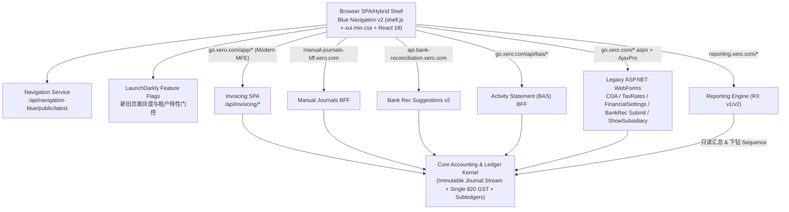

# 04_技术架构与实现原理研究

> **目标：** 从观测到的前端外壳、网络通信、数据一致性设计、税务水位线与审计机制中，还原 Xero 的工程实现原理，并提炼独立会计 SaaS 应当继承或规避的技术决策。  
> **证据基准：** `E01`–`E28b` 全量网页 DOM、Network 抓包与实测链路验证。

---

## 1. 整体架构拓扑（Observed Frontend & Service Mesh）

### 1.1 渐进式微前端演进特征 (`[Observed]` `E01`, `E06`, `E12`, `E22`, `E23`)
1. **Strangler Fig（绞杀者模式）实时现场：**
   - **壳层统一：** 不论用户在现代 React MFE（如 `/app/!W5gW!/journals`, `/bas`, `/contacts`）还是经典 ASP.NET WebForms（如 `/Accounts/Receivable`, `/Bank/BankRec.aspx`, `/GeneralLedger/ChartOfAccounts.aspx`），顶部始终由同一套 **`edge.xero.com/platform/shell/1.x/shell.js` + `xui.min.css` (24.8.0)** 渲染统一蓝色导航栏，用户无感知域跳转。
   - **混合态对账页实证 (`E22`–`E23`)：** 在银行对账页（`BankRec.aspx`）内，智能建议已拆分为现代微服务接口 `api.bank-reconciliation.xero.com/v2/suggestions`，而最终点击 `OK` 过账落库仍通过遗留 **`POST /ajaxpro/BankRec_BankRec.ashx`** 完成，同时顶部通过 `switch to new` / LaunchDarkly 控制新旧体验切换。
   - **版本功能门控 (`E13` vs `E23`)：** Cash Coding (`FastCoding.aspx`) 在 Demo Org 可用但在未升级 Trial Org 直接返回 404，说明路由访问与菜单下发由 `navigation-blue` 结合租户订阅 SKU/Entitlement 动态裁剪。

---

## 2. 核心会计内核实现原理解析 (`[Observed]` + `[Inferred]`)

### 2.1 子账与总账强一致（Subledger-to-GL Integrity）
- **读写分离 + 单向凭证流 (`[Observed]` `E07`, `E16`, `E24`):**
  - 业务单据（Invoice / Bill / Payment / BankTransaction）是**事件源状态机**，批准/核销操作在**同一个数据库事务**内生成唯一递增的 `Journal` 与平衡的 `JournalLines`，并更新客户/供应商汇总与 `Bank Balance in Xero`。
  - 通过 **COA 系统科目锁 + Manual Journal BFF 过滤（54 缩减至 47 科目）**，从入口端切断了“手工调整 AR/AP/Bank 导致总账余额 != 应收应付账龄报表 / 银行对账余额”这一常见财务软件灾难。

### 2.2 不可变分录流与冲销架构（Append-Only Ledger & Reversals）
- **为什么选择只增不改（Append-Only）+ Reversal Journal (`[Observed]` `E16` `ID 736 Reversal of ID 729`, `[Inferred]`)：**
  1. **完整审计溯源：** 永远不覆写历史 `JournalLines`，任何错账修正/作废保留完整的调整前后双边轨迹。
  2. **增量同步与 BAS 水位线基础：** BAS 引擎通过比对 **`JournalNumber > 上期已定稿 maxJournalNumber`** (`E28-NET`) 即可 $O(\Delta)$ 精确扫描自上次申报以来新增或迟到的分录变动（即 `Unfiled amounts`），而无需全表 Diff。如果原分录被就地修改且编号不变，水位线机制就会漏算！
  3. **报表快取失效友好：** 只增不改搭配 `JournalNumber` 单调递增，报表计算引擎更容易按时间切片与增量缓存聚合。

### 2.3 动态财年结转与动态科目重分类 (`[Observed]` `E18`, `E25`)
- **无物理年结凭证（Virtual Year-End Close）：**
  - Xero 不在每年 6 月 30 日写入数千条“将各损益科目清零结转到 `960 Retained Earnings`”的分录，从而允许企业在符合锁账权限的前提下回溯调整上一财年凭证而**无需反复反结账再重做年结凭证**！
  - 在 `reporting.xero.com` (`RX`) 执行试算表或资产负债表时，SQL/聚合层动态按组织 `FinancialYearEnd` 切分：`[FY_Start, Report_Date]` 的损益净额展示为 `Current Year Earnings`，`< FY_Start` 的历史损益累计叠加到 `Retained Earnings`。
- **Bank 负余额重分类：** 查询层判断 `AccountType == BANK && Balance < 0` 时，在资产负债表输出树中动态将其归入 `Current Liabilities`（`E18` 实测确认）。

### 2.4 金融数值精度与前端脱敏表达 (`[Observed]` `E28-NET` & `[Documented]`)
- **金额结构化表达：** BAS BFF 响应体中并未使用容易产生 IEEE-754 精度漂移的 JavaScript Float，而是传输 **`{ "whole": 39, "fraction": 50, "sign": "negative" }`** 整数拆分结构，并在后端数据库以定点数（`NUMERIC/DECIMAL`）存储、逐行计算 GST 后精确四舍五入至分（`0.01`）。

### 2.5 双栏银行对账并发建议管道 (`[Observed]` `E22`, `E23`)
- 银行流水的入账匹配不是单一 SQL `LIKE` 查询，而是结构化的 **5 路召回评分管道** (`bankRules`, `matches`, `batchPayments`, `memorisations`, `predictions`)，其中 `bankRules`（确定性规则）与 `matches`（金额+参考号+联系人精确/容差匹配未付发票）优先给出绿色 **OK** 按钮，降低用户操作步数至 **1 Click**，且点击 `OK` 时原子完成 Payment 过账与银行行锁定。

---

## 3. 架构借鉴与反模式规避清单（面向独立会计 SaaS Blueprint）

| Xero 技术现象 (`Observed`) | 对自研 SaaS 的结论 (`Proposed`) | 具体工程动作 |
|---|---|---|
| `.aspx` + `AjaxPro` + MFE 多套技术栈混跑 | **明确规避** | 从零采用统一模块化单体后端（REST/OpenAPI）+ 统一现代 React SPA 前端，绝不混用多套 UI 状态机制 |
| Append-Only `Journal` 流水 + 单调递增 `journal_seq` + 冲销分录 | **坚决采用** | 数据库层禁止 `UPDATE`/`DELETE` 已过账分录行（触发器或服务层强校验），配合 `BasWatermark` 精确捕获迟到分录 |
| Virtual Year-End Close（查询期动态归集当前财年收益与留存收益） | **坚决采用** | 无需物理结转分录，锁账依靠 `Lock Dates`（Soft vs Hard）保护，极大降低中小微用户反结账心智负担 |
| 金融金额禁止 Float，行级四舍五入 + BAS 整元取舍分离 | **坚决采用** | 核心账务使用定点数 `NUMERIC(18,4)` / 货币最小单位整数 + `Decimal` 运算；明确留出 BAS `G1` 含/不含税切换配置 |
| Server-Driven 租户边界（Header `X-Tenant-Id` + 权限/特性开关） | **坚决采用** | 每次 API 请求强制校验 `tenant_id`、角色（Adviser vs Standard）与锁账日期截断 |
